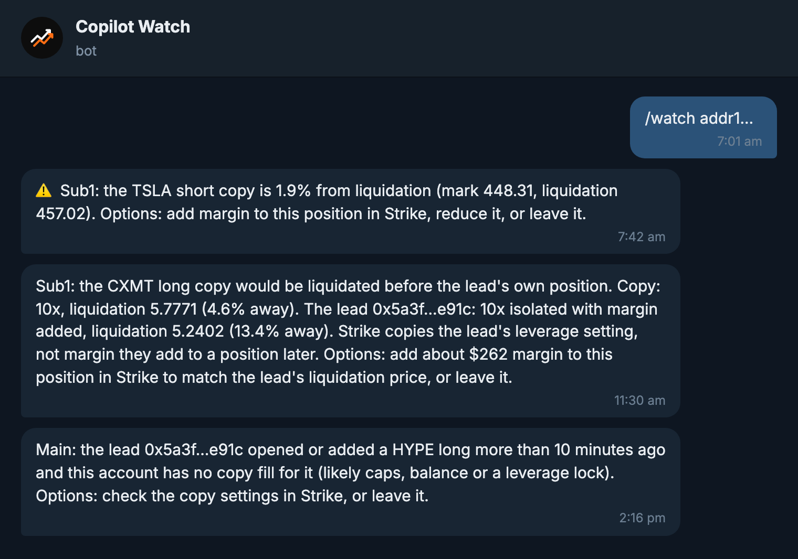

# Copilot Watch

[简体中文](README.zh-CN.md)

Telegram and Discord alerts for Strike copy traders: hear when a copy is close to liquidation, when the wallet you copy has left a position your copy still holds, or when one of its trades wasn't copied.

Built during the Strike Finance hackathon (22–24 Oct 2026). Not affiliated with Strike Finance. Not financial advice.

**Related tools:** [Copilot Check](https://github.com/benryandev/copilot-check) ([try it](https://strike.benryan.com.au)) shows whether a Hyperliquid wallet is worth copying on Strike, and paper-copies it before you risk money. [Strike Copilot](https://github.com/benryandev/strike-copilot) reviews your Strike account and helps you set copies up, by chatting with Claude on your own computer.

## Try it

- **Telegram:** open [@CopilotWatchBot](https://t.me/CopilotWatchBot) and send `/start`.
- **Discord:** [add the bot to your server](https://discord.com/oauth2/authorize?client_id=1561719393992319007&scope=bot+applications.commands&permissions=19456) (permissions: view channel, send messages, embed links), then run `/watch` in the channel where alerts should go.

`/watch` takes a Strike address (`addr1…`), a Strike nickname, or a sub-account ID (Strike app → Sub-accounts → Account ID → copy). An address or nickname watches the main account and every active sub-account; add a sub-account name to watch only that one (`/watch addr1… Sub1`).

| Command | What it does |
|---|---|
| `/watch <account> [sub-account name]` | Start watching; replies with each account's active copies |
| `/status` | Open copies, P&L and distance to liquidation, nearest first |
| `/settings liq=5` | Liquidation alert threshold, 1–20% (a second alert always fires at 2%) |
| `/unwatch <account>` | Stop watching one account |
| `/paper <0x wallet> [size]` | Paper copy a Hyperliquid wallet before copying it for real (no money); `/paper` alone lists this chat's paper copies. A summary arrives daily at 08:00 Brisbane time; the trial page is on [Copilot Check](https://strike.benryan.com.au). |
| `/lang en`, `/lang zh` or `/lang tw` | Language for this chat: English, simplified Chinese (简体中文) or traditional Chinese (繁體中文). Telegram picks Chinese automatically when your app is set to Chinese (traditional for Taiwan, Hong Kong and Macau settings); Discord stays English. |
| `/stop` | Stop everything here and delete this chat's data |



<sub>Sample alerts in the bot's own wording; the numbers are examples and the lead address is made up.</sub>

## Alerts

Checked about every 2 minutes. Each alert fires once per event (a near-liquidation alert can repeat after 6 hours), and says what happened plus the plain options. The first check after `/watch` only records a baseline, so history never triggers alerts.

| | Alert | When |
|---|---|---|
| A1 | Copy near liquidation | Mark within the set % of the copy's liquidation price, again at 2%. Stock and commodity markets add a note that Strike's price keeps moving while the real market is closed and can jump when it reopens. |
| A2 | Orphaned copy | The copy is still open but the lead holds nothing on that market, or holds the opposite side, in two checks in a row. If the lead was liquidated there, the alert says so. |
| A3 | Missed copy | The lead opened or added on a market Strike lists and this account has no copy fill for it within 10 minutes (likely caps, balance or a leverage lock). At most one per market per hour. |
| A4 | Lead close to liquidation | The lead's Hyperliquid cross maintenance margin reaches 60% of account value (Hyperliquid liquidates at 100%), on either the crypto or the stock/commodity account. |
| A5 | Lead moved money out | More than half of the lead's Hyperliquid account withdrawn in 24 hours (matters for fixed-ratio copies, which size off the lead's equity). |
| A6 | Copy liquidated or ended | A copy fill closed by liquidation or auto-deleverage, or the subscription changed to liquidated or stopped. |
| A7 | Copy liquidated before the lead | The copy is within 20% of liquidation and would be liquidated at least 2% (of mark) before the lead's own isolated position on that market, usually because the lead added margin after opening (Strike copies the leverage setting, not added margin). Gives the margin that would match the lead's liquidation price. Cross positions are left out: their liquidation depends on the lead's whole account, which A4 watches. |

### Acting on an alert

Copilot Watch only alerts. Acting would need your Strike API key, and Strike keys can trade with no read-only option, so the bot never asks for one. You act in the Strike app, or pair it with [Strike Copilot](https://github.com/benryandev/strike-copilot), which runs on your own computer with your key. It can add margin to an isolated copy (showing the new liquidation price first), tighten caps or stop the copy, and only after you say yes to each change.

## How it uses Strike

Public, unauthenticated reads only. Copilot Watch never asks for an API key: Strike keys can trade and have no read-only scope.

| Need | Endpoint |
|---|---|
| Resolve `/watch` | `GET /v2/account?blockchain_address=`, `GET /v2/account?account_id=`, `GET /v2/account/by-nickname?nickname=` |
| Which leads an account copies | `GET /v2/copy/leaderboard?status=active` (also `liquidated`, `stopped` when a copy ends) |
| Copied positions with mark and liquidation price | `GET /v2/copy/positions?account_id=` (fallback: `GET /v2/positions` + `GET /price/v2/premiumIndex`) |
| Copy fills, liquidations, ADL | `GET /v2/history/fill?account_id=` (`client_order_id` = `copy:<subscription>:…`, `auto_close_type`) |
| Markets and the Hyperliquid twin of each | `GET /v2/markets` |
| Lead side (Hyperliquid info API) | `clearinghouseState` (main and `xyz` dex), `userFillsByTime`, `userNonFundingLedgerUpdates`, `meta` |

## How it runs

A Cloudflare Worker (`src/worker.js`) with these entry points:

- `POST /telegram`: Telegram webhook, checked against a secret header (constant-time compare). Direct messages only.
- `/api/paper`: create and read Paper Copy trials for Copilot Check (CORS limited to strike.benryan.com.au; rate-limited; trials expire after 30 days).
- `/race/…`: the time-trial leaderboard for the Copilot Check ecosystem game (see [Race leaderboard](#race-leaderboard)).
- `POST /discord`: Discord HTTP interactions, Ed25519 signature and timestamp checked; replies are deferred and then edited, alerts are posted to the channel. Mentions are always disabled and Strike-supplied names are markdown-escaped.
- A cron every 2 minutes (`src/poll.js`) reads each watched account once and each lead once, however many chats watch them, diffs against the stored baseline, and sends alerts. A lead that Hyperliquid doesn't answer for is skipped for that round, never read as "holds nothing".
- A daily cron at 22:00 UTC (08:00 Brisbane, `src/paper-daily.js`) sends each chat a one-line summary of its paper copies.

State lives in Workers KV. `core/` (HTTP with backoff, Strike and Hyperliquid clients, market map) is shared with [Copilot Check](https://github.com/benryandev/copilot-check) and copied in by `pnpm sync-core`; a test checks the copy against its hash.

## Race leaderboard

Best lap per name for the RealFi racetrack in the ecosystem game (`src/race.js`; track numbers in `src/race-tracks.js`). CORS is limited to `https://strike.benryan.com.au` and `http://localhost:8766`.

| Endpoint | What it does |
|---|---|
| `GET /race/top?track=realfi-v1` | `{track, top: [{name, ms, at}]}`, the 10 fastest. No ids or IPs. |
| `GET /race/ghost?track=realfi-v1` | `{track, ghost: {name, ms, splits, trace, at}}` for the fastest lap, or `ghost: null`. `trace` is the lap's path for the ghost car (`[[t ms, x, z, heading], …]`, ten a second) or `null` for laps posted before ghosts existed; the page then rebuilds a ghost from the splits along the track's centreline. |
| `POST /race/time` | Body `{track, name, ms, splits, trace?}`, `splits` being the cumulative time in ms at each checkpoint, `trace` the optional ghost path (2 to 400 samples, times increasing and inside the lap, no two samples further apart than 40 m/s allows (looser than the 30 m/s segment check: positions are rounded and a landing moves the car a little between frames), starting within 1 s of the line and ending within 1.5 s of it, covering at least 70% of the lap length; else `bad_trace`). Replies `{ok: true, rank, best, top}`: `rank` is where the name's best now sits (1-based, `null` outside the top 100), `best` is true when this time became the name's new best on the board. Errors are `{error}` with 400 (`unknown_track`, `bad_name`, `rude_name`, `bad_splits`, `bad_ms`, `lap_too_fast`, `segment_too_fast` + `segment`), 403 (`origin`), 413 (`too_large`) or 429 (`rate`, with `Retry-After`). |
| `DELETE /race/time` | Admin only (`x-race-admin` header). Removes by `id` or `name` (case-insensitive) from `track`, given in a JSON body or the query string. `{ok, removed}`. |
| `POST /race/event` | Body `{track, kind}`, `kind` one of `open`, `found`, `start`, `finish` (sent by the page with `sendBeacon`). 204, nothing stored about the visitor beyond a hashed key that expires after 2 days. `post` is counted by the worker when a time is accepted. |
| `GET /race/stats?track=realfi-v1&days=14` | Admin only. `{track, days: [{day, open, found, start, finish, post}]}`, newest UTC day first: visitors per day who reached each stage, each counted once per stage per day. Kept 90 days. |

Checks: the track must be known; the name is 1–20 characters once invisible and bidi characters are stripped and spaces trimmed, has no control characters and passes a short rude-word list (case, accents, l33t and separators like `f.u.c.k` undone first; words like "cunt" only match whole, so Scunthorpe passes). There is one split per checkpoint, strictly increasing, and every segment, the last one to the line included, must take at least its length ÷ 30 m/s (the car tops out at 24 m/s). A lap must be at least the track length ÷ 30 m/s and under 30 minutes.

Limits: one post per IP every 30 seconds. Every post that parses as JSON counts, valid or not, so probing the checks is slow; the IP is kept only as a hash in a key that expires after 60 s (KV's minimum). One KV key per track (`race:top:<track>`) holds the top 100, one entry per name (compared case-insensitively), sorted by time and then by who set it first. Bodies over 16 KB are refused. Two posts landing in the same instant can race on that key (last write wins); fine at this scale.

The admin token is a Worker secret, which Ben sets himself: `pnpm dlx wrangler@4 secret put RACE_ADMIN_TOKEN`. Without it, deletes are refused. With the header, `GET /race/top` also returns `all` (every entry, with ids) instead of `top`.

```sh
curl -X DELETE 'https://copilot-watch.benryan.workers.dev/race/time?track=realfi-v1&name=SomeName' \
  -H 'x-race-admin: YOUR_RACE_ADMIN_TOKEN'
```

No `wrangler.toml` change is needed: it uses the existing `KV` binding.

## Project submissions

The form at `https://strike.benryan.com.au/ecosystem/submit/` posts here (`src/submit.js`); same CORS origins as the race board.

| Endpoint | What it does |
|---|---|
| `POST /submit` | Body `{type: "new"\|"update", listing, name, tagline, category, uses[], description, site, x, github, logo, contact, notes, permission: true, company, elapsed}`. Checked (lengths, https links, a github.com link for `github`, an X handle, a known category and uses), stored as `sub:item:<at>-<id>` for 180 days, and sent to `SUBMIT_TG_CHAT` on Telegram as plain text. `{ok: true, id}`. Errors: 400 `bad_field` + `field`, 403 `origin`, 413 `too_large`, 429 `rate` (3 an hour per IP), 503 `busy` (30 a day in total). A filled `company` honeypot or `elapsed` under 3 s gets `{ok: true}` and is dropped. |
| `GET /submit/list` | Admin only (`x-race-admin`). `{items}`, every stored submission, newest first. |

Nothing goes live from here: an approved project is added by hand to copilot-check `ecosystem/js/projects.js` and the site redeployed. The alert chat is a Worker secret: `pnpm dlx wrangler@4 secret put SUBMIT_TG_CHAT`. Without it, submissions are still stored.

## Privacy

Stored per chat: the Telegram chat id or Discord channel and server ids, the user id that set the watch (Discord permissions), the accounts watched, the alert threshold and language, and per account the last 200 fill ids and open copies seen (public data). Alert text is stored only when Telegram or Discord can't take it, for up to an hour so it can be resent; logs carry counts only. `/stop` deletes the chat's data; accounts no longer watched by anyone are deleted with it. Usage is kept as daily totals with no ids attached (new chats, `/stop`s, paper copies made, arrivals from the Copilot Check link), for 400 days. Race leaderboard: the name, lap time, checkpoint splits and when it was set, for the top 100 per track; no IPs or account ids. Race funnel: daily counts only, plus a hashed visitor key per stage that expires after 2 days. Project submissions: what the form asks for (including the contact given), for 180 days; no IPs.

## Limits

- Per chat: 5 accounts, 10 commands a minute. Per Discord server: 3 channels; per Discord user: 3 channels. Paper copies: 3 per chat, 500 in total. In total: 300 chats (a prototype limit). Each 2-minute run reads at most ~900 public endpoints; accounts and leads beyond that roll over to the next run. In Discord, the commands that change a watch need Manage Server by default (server admins can widen that in Server Settings → Integrations), and only the person who set a watch or a member with Manage Server can change or stop it. Names taken from Strike are stripped of link and mention characters.
- Strike's copy list can lag up to 10 minutes, so a brand-new or just-stopped copy can take that long to show.
- Caps, exclusions and leverage settings aren't public, so a missed-copy alert can only say "likely caps, balance or a leverage lock".
- Hyperliquid rate-limits by IP and Workers share IPs; a busy round skips the lead rather than guessing.

## Run it yourself

```sh
pnpm test                      # node --test, no dependencies
pnpm sync-core                 # copy core/ from ../copilot-check
pnpm dlx wrangler@4 secret put TELEGRAM_TOKEN            # and DISCORD_TOKEN, TELEGRAM_WEBHOOK_SECRET
pnpm deploy
node scripts/set-telegram.mjs  # webhook, commands, description
node scripts/register-discord.mjs --guild <id>   # or --global
node scripts/register-discord.mjs --set-endpoint https://<worker>/discord
node scripts/stats.mjs         # usage counts (no ids)
```

Tokens are read from `.secrets/` (git-ignored) and never printed.

## Licence

MIT. Not financial advice. Not affiliated with Strike Finance. Past results don't predict future ones.

Built by [Ben Ryan](https://benryan.com.au).

## Accounts (public identifiers, not secrets)

- Telegram bot: [@CopilotWatchBot](https://t.me/CopilotWatchBot)
- Discord application ID: `1561719393992319007`
- Discord public key: `50e537c588ad61fa8b38b6ced330efecd368c0c74f351ea710808beba8d6cb48` (verifies interaction signatures)
- Discord test server ("Copilot") guild ID: `1561721893071880303` (slash commands are registered globally; the guild ID is only for testing with `--guild`)
- Cloudflare: Workers Paid account; KV namespace `copilot-watch` (`22fd6ef1fa074edea7689bdaa2b5378f`); Worker at `copilot-watch.benryan.workers.dev`.
